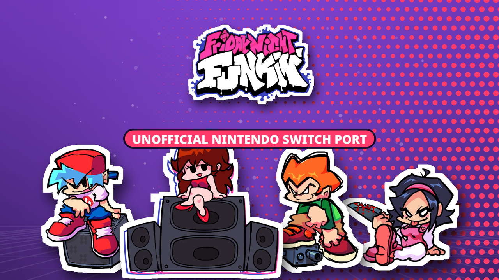

<p align="center">
  
</p>

# Friday Night Funkin' V-Slice for Nintendo Switch (unofficial)

A homebrew port of [Friday Night Funkin'](https://github.com/FunkinCrew/Funkin) **V-Slice 0.8.7**, the official engine by The Funkin' Crew, to the Nintendo Switch. The goal is the PC game, 1:1: same songs, charts, stages, shaders, cutscenes and scoring, running natively on the console.

The `.nro` contains **no game assets**. On first launch it downloads the official files straight from The Funkin' Crew's repository ([FunkinCrew/funkin.assets](https://github.com/FunkinCrew/funkin.assets), at the exact commit of the game version), checks every file against its SHA-256 and starts the game. They can also be copied from a computer.

> This project is not affiliated with The Funkin' Crew Inc. or Nintendo. Friday Night Funkin' is © The Funkin' Crew Inc.; its art, music and charts are proprietary and are never redistributed by this project.

---

## Contents

- [Features](#features)
- [Installing](#installing)
- [First launch: the game files](#first-launch-the-game-files)
- [Building](#building)
- [Testing](#testing)
- [How the port is organized](#how-the-port-is-organized)
- [Status and roadmap](#status-and-roadmap)
- [Licences and credits](#licences-and-credits)

## Features

- **V-Slice 0.8.7** with every week, Weekend 1, the Erect and Pico mixes, Freeplay, Story Mode, Character Select, the results screen and Polymod mods.
- **Asset installer**: a small `.nro` (about 80 MB) that downloads the official files from GitHub, resumes after a lost connection or a closed game, and verifies every file before keeping it.
- **Cutscenes from the official video files**, decoded on a free CPU core by a minimal LGPL build of FFmpeg (H.264, HEVC and VP9; MP4 and Matroska) and converted on the GPU.
- **Audio driver for Switch** that replaces SDL2's, which can stall for good when its thread runs late; audio recovers after HOME, sleep and long sessions.
- **Memory management for the console's heap**: large-block region, banded texture uploads, single-copy image decoding and per-stage cache purges, tested week by week against the console's memory budget.
- **Clocks**: GPU at 460.8 MHz in handheld and 768 MHz docked (the highest speeds Nintendo allows games), with a CPU boost while loading.
- **Switch controls**: Nintendo button layout and names in menus, HD Rumble, and an options page for Switch settings.

## Installing

Requirements:

- A Switch running custom firmware with the homebrew menu ([Atmosphère](https://github.com/Atmosphere-NX/Atmosphere)).
- The homebrew menu opened **from a game** (hold R while launching any title), so the game gets the full amount of memory. Applet mode (from the Album) does not have enough memory for the game.
- About 1.1 GB free on the SD card, and internet on the console or a computer to copy the files.

Steps:

1. Download `Funkin.nro` from the [latest release](../../releases).
2. Copy it to `/switch/Friday-Night-Funkin/Funkin.nro` on the SD card.
3. Launch it from the homebrew menu and follow the first-launch screen.

Saves, mods and logs live next to it, in `/switch/Friday-Night-Funkin/` (`saves/`, `mods/`). Mods use the same format as on PC.

## First launch: the game files

When the official files are missing, the game shows what it needs (size and number of files) and offers to download them:

- Files come only from `raw.githubusercontent.com/FunkinCrew/funkin.assets/<commit>/…`, for the exact version of the game. Nothing else on the console is touched: the files go to `/switch/Friday-Night-Funkin/assets/`.
- Each file is written as `.part`, checked against the SHA-256 listed in the build, and only then renamed. A lost connection is retried automatically; closing the game keeps everything downloaded so far, and the next launch continues from there.
- When everything is in place, the game restarts itself through the homebrew menu and loads normally. Later launches skip the check (a few milliseconds).

**Without internet on the console:** on a computer, download the archive of the official repository at the commit shown on screen (`github.com/FunkinCrew/funkin.assets/archive/<commit>.zip`), extract it and copy everything inside its folder to `/switch/Friday-Night-Funkin/assets/`, so that `assets/preload/` exists. The game checks the files on the next launch.

## Building

### Requirements

- [devkitPro](https://devkitpro.org/wiki/Getting_Started) with `devkitA64`, `libnx`, `switch-tools` and these portlibs:

  ```bash
  sudo dkp-pacman -S switch-sdl2 switch-sdl2_image switch-sdl2_gfx switch-sdl2_mixer switch-sdl2_net \
    switch-mesa switch-glad switch-libdrm_nouveau switch-openal-soft switch-freetype switch-harfbuzz \
    switch-libpng switch-libjpeg-turbo switch-libwebp switch-libvorbis switch-libvorbisidec switch-libogg \
    switch-opusfile switch-libopus switch-mpg123 switch-libmodplug switch-flac switch-zlib switch-bzip2 \
    switch-curl switch-pkg-config switch-cmake
  ```

- [Haxe](https://haxe.org/download/) 4.3.7, Git, Python 3, `make`, `curl` and a host C compiler (`gcc`). The first build downloads the FFmpeg 7.1 source from ffmpeg.org.

### Setup

```bash
git clone --recurse-submodules <this repository>
cd Funkin
haxelib --global install hmm
haxelib --global run hmm setup
hmm install                                       # libraries go to ./.haxelib
python3 tools/nx-tools/sync_haxelibs.py           # puts every git library at the commit pinned in hmm.json
haxelib run lime rebuild switch                   # builds liblime.a for Switch
```

The Switch forks of lime, OpenFL, flixel and hxcpp are pinned in `hmm.json`. `sync_haxelibs.py` is needed because hmm checks out the head of a git library's branch instead of its pinned commit.

### Build

```bash
# Public build: the asset-less .nro with the installer
haxelib run lime build switch -release -DNX_SD_ASSETS
python3 tools/nx-tools/package_sd_build.py        # -> export/release/switch/bin/Funkin-sd.nro

# Test build: same, plus logs, telemetry, autotests and test shortcuts
haxelib run lime build switch -release -DNX_SD_ASSETS -DNX_DEV_TOOLS
python3 tools/nx-tools/package_sd_build.py

# Development build with the assets inside the .nro (no installer)
haxelib run lime build switch -release -DNX_DEV_TOOLS
```

Notes:

- The first build compiles FFmpeg (`tools/nx-tools/build_ffmpeg_nx.sh`) into `export/nx-generated/ffmpeg`; later builds reuse it.
- `package_sd_build.py` repacks the `.nro` with a RomFS that only holds lime's asset manifests, the list of official files (with sizes and SHA-256, generated from the `assets` submodule at the official commit) and the code licence. It fails if anything else would end up inside.
- The `assets` submodule must sit at the commit of the official tag; the build checks it.
- `tools/nx-tools/deploy_switch.sh [file.nro]` copies a build to the console over FTP or MTP (after backing up logs and saves).

## Testing

- **Citron** (Switch emulator): `./tools/nx-tools/run_citron_autotest.sh <SCENARIO> <TIMEOUT>` runs a scripted scenario in a test build and checks the game's own trace log. Main scenarios: `REGRESSION_SUITE`, `CUTSCENE_SKIP`, `WEEKEND1_FULL`, `MEMORY_BUDGET`, `AUDIO_DRIVER_STALL`, `SOAK` and, for public builds, `PUBLIC_SMOKE`.
- **Installer on PC**: `tools/nx-tools/installer-test/run_tests.py <manifest>` (verification, repair and state) and `run_download_test.py <manifest>` (a real download from GitHub).
- **Isolation check**: `python3 tools/nx-tools/check_switch_isolation.py` proves that the game files compile on every other platform exactly as the official ones.
- **Console**: test builds write `logs/deep_engine_trace.log` and `logs/installer.log` with timings, memory and audio telemetry.

## How the port is organized

| Path | What it holds |
| --- | --- |
| `source/funkin/`, `assets/` | The official game and its assets submodule. Switch changes in game files only exist inside `#if switch`, so every other platform builds exactly the official code. |
| `source/nx/` | The Switch port: audio driver, video player, asset installer, memory, clocks, input, telemetry and automated tests. |
| `source/nx/macro/` | Compile-time patches applied to lime and OpenFL on Switch, which fail the build if the library code they target changes. |
| `tools/nx-tools/` | Build, packaging, deployment and test tools. |
| `docs/SWITCH_*.md` | Tracker of builds and incidents, technical status, upstream changes per version and session guide (in Spanish). |

Updating to a new V-Slice version is a merge of the official tag plus a check that the isolation checker still reports zero changes outside Switch; the procedure is in `docs/SWITCH_TECHNICAL_STATUS.md`.

## Status and roadmap

Done:

- V-Slice 0.8.7 merged and validated in Citron (regression suite, Weekend 1, memory budget, audio stalls, soak).
- Asset-less `.nro` with downloader and verifier.
- Native cutscenes from the official video files.

In progress / planned:

- Console validation of the installer (with and without internet, interrupted downloads).
- ASTC textures generated on the console after the download, to cut memory and loading times.
- Performance: internal resolution, garbage collector pauses and animation CPU cost in the heaviest songs.
- Touch controls in handheld mode, like the mobile version.
- Lime 8.3 / SDL3 on Switch (branch `feature/switch-lime83-sdl3`), to follow upstream's newer input and library features.

Known limitations:

- Mods written for APIs added in flixel 6.2 / OpenFL 9.5 (V-Slice 0.8.6+) may not run until the lime 8.3 work lands.
- Editors (chart, stage, animation) are not included, as on mobile.

## Licences and credits

- The game code is © The Funkin' Crew Inc., under the [Apache License 2.0](../LICENSE.md); the Switch port code in this repository uses the same licence. Game assets are proprietary to The Funkin' Crew and are not part of this repository's releases.
- The `.nro` links [FFmpeg](https://ffmpeg.org/) (LGPL 2.1+, minimal build script in `tools/nx-tools/build_ffmpeg_nx.sh`), [OpenAL Soft](https://openal-soft.org/) (LGPL 2.0+), [SDL2](https://libsdl.org/) (zlib), [curl](https://curl.se/) (curl licence), Mesa, FreeType, HarfBuzz and the other devkitPro portlibs under their own licences.
- This port started from the first V-Slice 0.8.1 Switch port by [FunkinNXTeam](https://github.com/FunkinNXTeam) (ヴェン, Andres_Github and the team), which brought the game to the console for the first time. Thank you for that first attempt.
- [Slushi](https://github.com/Slushi-Github) made [lime-nx](https://github.com/Slushi-Github/lime-nx), the Switch backend of lime this port runs on, and [hx_libnx](https://github.com/Slushi-Github/hx_libnx), and also made [Switch Funkin'](https://github.com/Slushi-Github/Switch-Funkin), a Psych Engine port. This project is a separate port of the official V-Slice engine.
- [devkitPro](https://devkitpro.org/) (devkitA64, libnx and the Switch portlibs), [Citron](https://citron-emu.org/) for automated testing, and the HaxeFlixel, OpenFL and lime projects.
- Friday Night Funkin' by [The Funkin' Crew](https://github.com/FunkinCrew): ninjamuffin99, PhantomArcade, evilsk8r and Kawai Sprite. Please support the official game.
